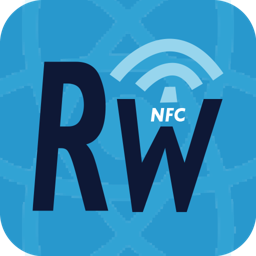
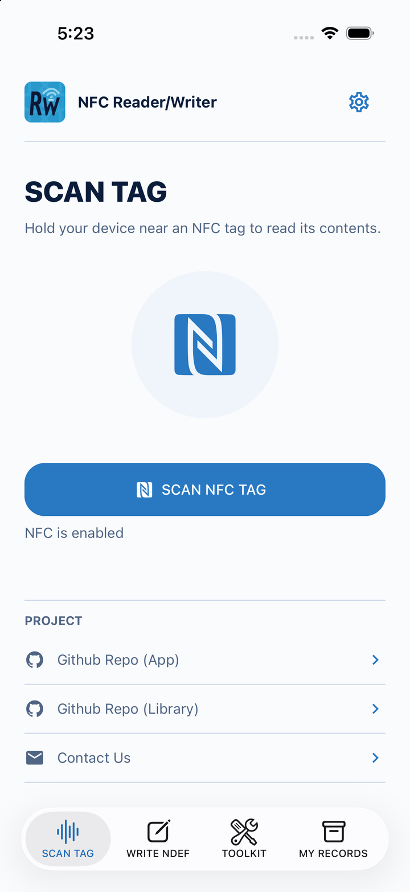
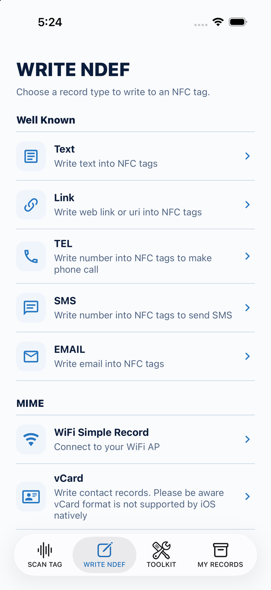
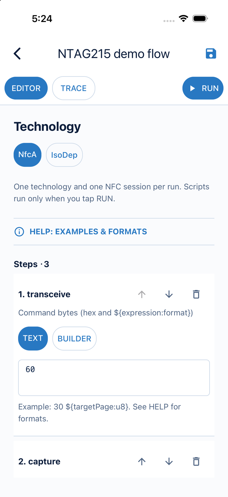
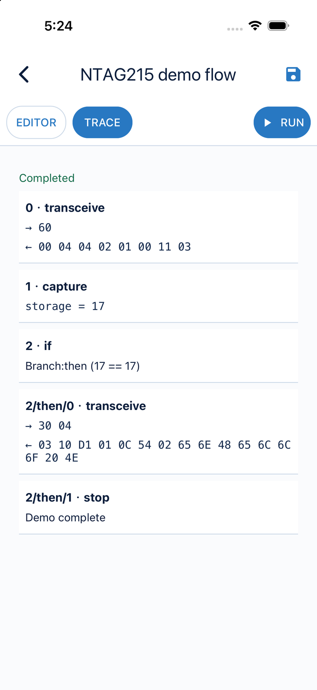
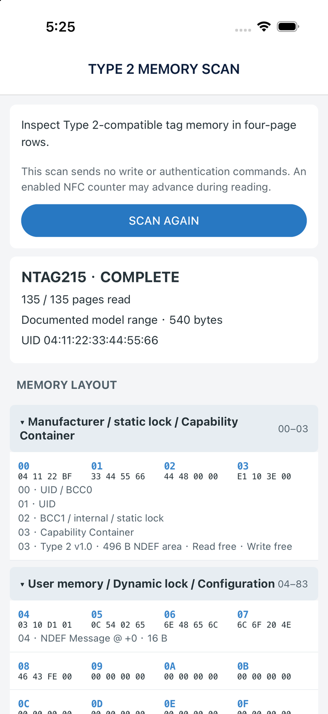
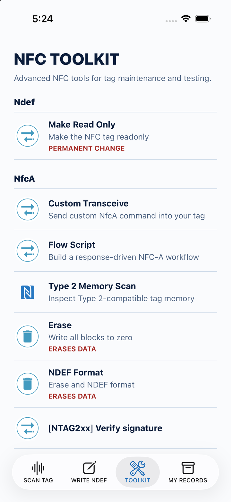

  

<h1 align="center">NFC Open ReWriter</h1>

<strong>Read tags. Write records. Build NFC flows.</strong>

  An open-source NFC workbench for iOS and Android, built with React Native. 
  Read and write NFC tags, inspect readable Type 2 memory, and build response-driven command flows.

  <a href="https://apps.apple.com/tw/app/nfc-rewriter/id1551243964">Download for iOS</a> ·
  <a href="https://play.google.com/store/apps/details?id=com.washow.nfcopenrewriter">Download for Android</a> ·
  <a href="https://revtel.github.io/react-native-nfc-rewriter/">Project website</a> ·
  <a href="mailto:nfctogo@gmail.com?subject=NFC%20project%20inquiry">Discuss an NFC project</a>

> **Development preview:** This README describes the current source. Screenshots and newer features, including Flow Script, Type 2 Memory Scan, and the English / 繁體中文 / 日本語 interface, may differ from the versions currently available in the stores.

## What you can do

- **Read, write, and reuse.** Inspect tag identity, technologies, and NDEF data. Write text, links, phone / SMS / email shortcuts, Wi-Fi records, and vCards. Save records to open, copy, and share later.
- **Let tag responses shape the next command.** Build NFC-A or ISO-DEP flows with captured response variables, dynamic command bytes, conditions, delays, and bounded repeats. Review commands, responses, variables, and branch decisions in the trace.
- **Look beneath the record.** Inspect readable Type 2 memory pages with raw bytes and annotations, including model-specific layouts for NTAG213, NTAG215, and NTAG216.
- **Extend the source.** Explore an MIT-licensed React Native app powered by [react-native-nfc-manager](https://github.com/revtel/react-native-nfc-manager), or talk to the team about integration and custom development.

## Inside the app

The screenshots below show the development build in English. Click a screenshot to view the full image.

<table>
  <tr>
    <td align="center" width="50%">
       
      <strong>Scan tags</strong> Read tag information and NDEF records.
    </td>
    <td align="center" width="50%">
       
      <strong>Write NDEF</strong> Choose a record type for your tag.
    </td>
  </tr>
  <tr>
    <td align="center" width="50%">
       
      <strong>Build NFC flows</strong> Compose commands and capture response values.
    </td>
    <td align="center" width="50%">
       
      <strong>Inspect the execution</strong> Follow commands, responses, and branch decisions.
    </td>
  </tr>
  <tr>
    <td align="center" width="50%">
       
      <strong>Inspect Type 2 memory</strong> View readable pages alongside their interpretation.
    </td>
    <td align="center" width="50%">
       
      <strong>Explore the toolkit</strong> Reach commands, flows, and tag utilities.
    </td>
  </tr>
</table>

All screenshots use the app’s UI with demo tag data in an iOS simulator. They illustrate the interface and do not represent a new hardware test. Image provenance is recorded in [screenshot-sources.json](./promotion/screenshot-sources.json).

## Features and compatibility

| Area | Capabilities |
| --- | --- |
| Read | Tag UID, available technologies, and NDEF messages |
| Write NDEF | Text, URI / custom schemes, telephone, SMS, email, Wi-Fi Simple Record, and vCard |
| Saved records | Save, open, copy, and share NDEF records, custom commands, and flow scripts |
| Custom commands | NFC-A and NFC-V transceive, and ISO-DEP APDU commands, subject to platform and tag support |
| Flow Script | One NFC-A or ISO-DEP technology per run; variables, response capture, dynamic commands, conditions, bounded repeats, delays, and per-step trace |
| Type 2 Memory Scan | Model-specific page ranges for identified NTAG213 / 215 / 216; bounded CC-declared data-area scans for other compatible Type 2 tags |
| Tag utilities | Formatting, erase, and read-only operations where supported; NTAG213 / 215 password protection; NTAG2xx signature verification; NTAG424 DNA signature commands and tamper detection; SIC43NT rolling-code verification |
| Interface | English, Traditional Chinese, and Japanese; system language or manual selection; light and dark appearance |

An NFC-capable device and a compatible tag are required. Available technologies and operations depend on the platform, device, and tag.

How a written record is opened depends on the receiving device. iOS does not natively open NFC vCard records. Generic Type 2 scans are not complete physical-memory dumps: unreadable or unverified pages remain unavailable, and incomplete results do not establish the reason for a read failure. Memory scanning sends identification and read commands only; tag-side read counters may still advance.

## Build something with us

Have an NFC product or an existing app that needs NFC? Talk to the team about prototyping, React Native integration, and custom mobile development.

[Discuss an NFC project](mailto:nfctogo@gmail.com?subject=NFC%20project%20inquiry) · [NFC To GO](https://www.nfctogo.com/) · [Revteltech](https://www.revtel.tech/)

Tell us your target platform, tag or hardware, and what you want to build. You can also email **nfctogo@gmail.com** directly.

## Development

Use Node.js 22.11 or newer and npm 10.9.7. `package-lock.json` is the
project's only dependency lockfile; install with `npm ci`.

The postinstall script repairs the Node-only React DevTools standalone bundle
to load the patched npm versions of `ws` and `shell-quote`. The React Native
backend stays on 6.1.5. Source and output hashes guard this compatibility patch;
review or remove it when upgrading `react-devtools-core`. Do not skip install
scripts when using standalone DevTools.

The dependency fixes follow the upstream [shell-quote advisory](https://github.com/advisories/GHSA-pqg4-j6r4-53mv)
and [ws advisory](https://github.com/advisories/GHSA-96hv-2xvq-fx4p).

Run `npm test` for unit tests and `npm start` for Metro. Use `npm run ios` or
`npm run android` to build and launch the app locally.

Run `npm run test:dependency-security` after changing the DevTools compatibility
patch or its dependencies. It checks shell escaping and bounded WebSocket input
using the dependency exports from the patched standalone bundle.

The project website lives in [`docs/`](./docs/). See [website maintenance and GitHub Pages setup](./promotion/README.md) for local preview and publishing instructions.

## Credits and license

Made by [whitedogg13](https://github.com/whitedogg13) and [Revteltech](https://github.com/revtel). Original project credits also include Washow.

Built with [React Native](https://github.com/facebook/react-native) and [react-native-nfc-manager](https://github.com/revtel/react-native-nfc-manager).

[MIT license](./LICENSE) — Copyright Richie Hsieh and Revteltech.
